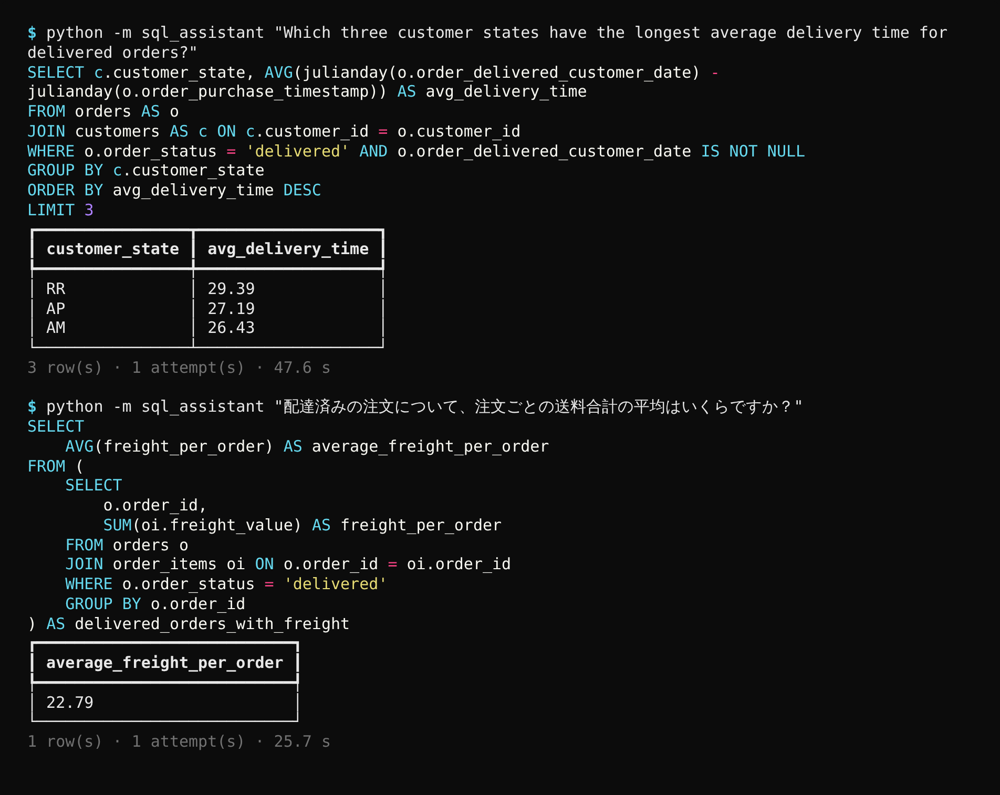
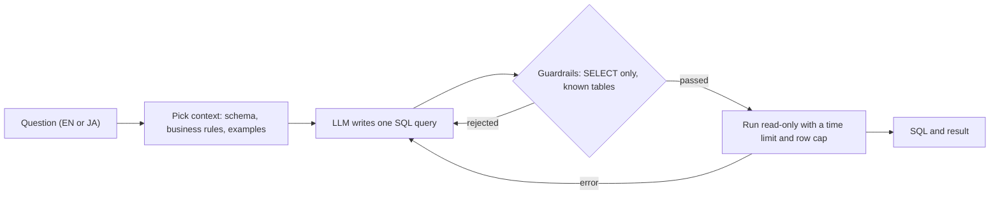

# LLM SQL Assistant

[](https://github.com/iramadhanil/llm-sql-assistant/actions/workflows/tests.yml)

Ask a question about an e-commerce database in English or Japanese and get back the SQL and the answer. Every query is checked before it runs, and a test set of 30 questions with reference answers shows how often the answers are right.



## Why I built this

A lot of my work is turning other teams' questions into numbers they can use. LLMs can write SQL, but in practice two things matter more than the model itself: whether a query is safe to run, and whether the answer is actually correct. This project is a small, measured test of both, on real data.

## How it works



1. **Context.** The question is matched against a [data dictionary](docs/data_dictionary.yaml). Column descriptions always go into the prompt. Business rules, such as "revenue is the sum of item prices, not payments", and two [worked examples](docs/examples.yaml) are added only when their keywords appear in the question.
2. **Generation.** Any OpenAI-compatible model writes one SQLite query. The results below use Qwen3-4B-Instruct running locally through llama.cpp, so no data leaves the machine.
3. **Guardrails.** [sqlglot](https://github.com/tobymao/sqlglot) parses the query and allows only a single SELECT on known tables. The query then runs on a read-only connection with a time limit and a row cap. Either layer on its own would stop a destructive query.
4. **One retry.** If the query is rejected or fails, the error goes back to the model once.

## Results

Every run uses Qwen3-4B-Instruct-2507 (Q4_K_M) through llama.cpp on a 2-core CPU, at temperature 0, one run per setup.

| Prompt | Main set (30 questions) | Held-out set (10 questions) |
|---|---|---|
| Schema only | 21/30 (70%) | 4/10 (40%) |
| Schema + business rules + examples, first version | 24/30 (80%) | not run |
| Schema + business rules + examples, second version | **26/30 (87%)** | **9/10 (90%)** |

Main set with the second version: easy 9/9, medium 13/14, hard 4/7; English 20/24, Japanese 6/6. Each question took about 30 seconds on the CPU.

**What the runs show**

- **Business definitions matter more than SQL syntax.** With the schema alone, the model counted order-level customer IDs instead of people, averaged freight per item instead of per order, and added payments into revenue. Short business rules in the prompt fixed most of these.
- **Context can also hurt.** In the first version the percentage rule was always in the prompt, and the model multiplied an average and a median by 100. The second version adds that rule only when a question asks for a percentage, and states the customer rule as a direct instruction.
- **The held-out set checks for overfitting.** The second version was written after reading the first version's mistakes on the same 30 questions, so its 87% is optimistic. Ten new questions were written before the second run: schema only scored 4 of 10 and the full prompt 9 of 10.
- **Multi-step queries are the weak spot.** The questions the model still misses need a running total, a top three within each year, a count that avoids duplicate rows after a join, or a rate built from a nested aggregate. Worked examples for these patterns, or a larger model, are the next things to try.

Every generated query is in [`runs/`](runs/), and each run has a scored report in [`results/`](results/).

## Try it

You need Python 3.10 or newer.

```bash
git clone https://github.com/iramadhanil/llm-sql-assistant
cd llm-sql-assistant
python -m venv .venv
source .venv/bin/activate          # Windows: .venv\Scripts\activate
pip install -r requirements.txt
pytest                              # unit tests, no data or model needed
```

**1. Build the database.** Download the Olist CSV files ([data/README.md](data/README.md)), then:

```bash
python scripts/build_db.py --csv-dir data/csv
```

**2. Start a model.** Any OpenAI-compatible endpoint works. The results below used Qwen3-4B-Instruct-2507 (Q4_K_M), which runs on a normal CPU. Two ways to run it locally:

```bash
# llama.cpp (model file from https://huggingface.co/unsloth/Qwen3-4B-Instruct-2507-GGUF)
pip install "llama-cpp-python[server]" --extra-index-url https://abetlen.github.io/llama-cpp-python/whl/cpu
python -m llama_cpp.server --model Qwen3-4B-Instruct-2507-Q4_K_M.gguf --n_ctx 4096

# or Ollama
ollama pull qwen3:4b-instruct-2507-q4_K_M
export SQL_ASSISTANT_BASE_URL=http://localhost:11434/v1     # Windows: set SQL_ASSISTANT_BASE_URL=...
export SQL_ASSISTANT_MODEL=qwen3:4b-instruct-2507-q4_K_M
```

For a hosted model, set `SQL_ASSISTANT_BASE_URL`, `SQL_ASSISTANT_MODEL` and `SQL_ASSISTANT_API_KEY` instead.

**3. Ask a question.**

```bash
python -m sql_assistant "Which customer state has the most orders?"
python -m sql_assistant --show-prompt "2018年に購入された注文は何件ですか？"
```

**4. Run the evaluation, or re-score a recorded run without a model.**

```bash
python -m sql_assistant.evaluate --mode with_context --name my-model
python -m sql_assistant.evaluate --questions eval/holdout.yaml --mode with_context --name my-model-holdout
python -m sql_assistant.evaluate --replay runs/qwen3-4b-v2__with_context.jsonl
```

## How answers are scored

Each of the [30 main questions](eval/questions.yaml) and the [10 held-out questions](eval/holdout.yaml) has a reference query. A model's answer counts as correct when its result has the same rows as the reference result:

- row order does not matter;
- extra columns are fine, as long as every reference column is there;
- whole numbers must match exactly, and other numbers may differ by 0.5%, so rounding is not a mistake;
- a one-row answer may hold the values of a one-column reference side by side. This rule was added after the first run, when the model answered "late vs on time" as two columns instead of two rows, and every run was re-scored with it.

The rules are in [`sql_assistant/compare.py`](sql_assistant/compare.py) and covered by unit tests.

## Limitations

- 30 questions is a small test set. One question moves the accuracy by 3.3 points.
- One model, one run at temperature 0. A larger model would probably score higher, and the harness makes that easy to check.
- Keyword retrieval is deliberately simple. With hundreds of tables, embeddings would be the next step.
- Guardrails stop writes and runaway queries. They cannot catch a valid query that answers the wrong question. That is what the test set is for.

## Project layout

```text
sql_assistant/   assistant, prompts, guardrails, scoring and the command line tool
docs/            data dictionary, business rules and worked examples
eval/            the 30 main and 10 held-out questions with reference SQL
runs/            the SQL the model wrote, one line per question
results/         scored reports for each run
scripts/         database build script
tests/           unit tests
```

## Data and license

The data is the [Brazilian E-Commerce Public Dataset by Olist](https://www.kaggle.com/datasets/olistbr/brazilian-ecommerce) (CC BY-NC-SA 4.0). It is not stored in this repository. The code is released under the MIT license.

Built with help from an AI coding assistant.

## 日本語の概要

英語または日本語の質問から、LLMがSQLを生成して回答するアシスタントです。生成されたSQLは実行前にチェックし（SELECT文のみ、既知のテーブルのみ）、読み取り専用の接続で実行します。30問の評価セット（うち6問は日本語）で正答率を測っており、業務ルール（売上や顧客の定義など）をプロンプトに加えると、正答率は70%から87%に上がりました。調整に使っていない新しい10問でも、40%から90%に上がっています（4Bモデル、CPUで実行）。
